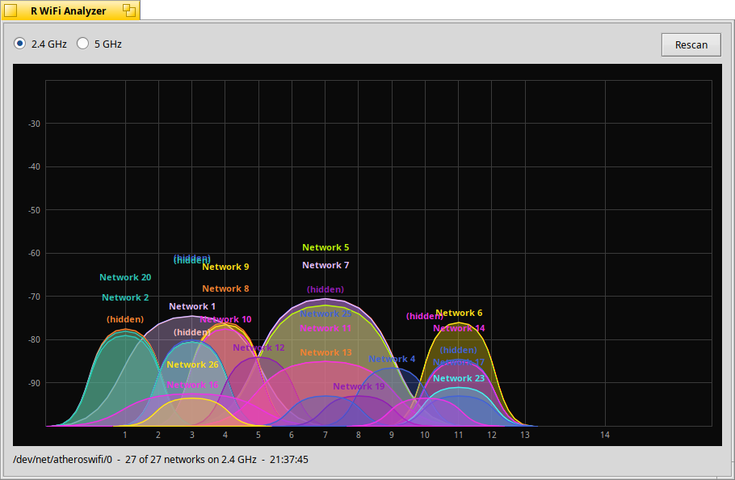

# R WiFi Analyzer - Haiku OS

*[한국어 버전](README.ko.md)*

*The Haiku OS port. See the [repository README](../README.md) for the
[Windows Phone](../winphone) and [macOS](../mac) ports.*

Wi-Fi channel and signal strength graph for Haiku OS. Every access point in range is
drawn as a curve over the channel it occupies, with its height set by signal
strength in dBm.

- 2.4 GHz and 5 GHz, switched from the radio buttons above the graph
- Rescans every 5 seconds, or on demand
- Each network keeps the same colour between scans
- 40 MHz networks are drawn 42 MHz wide, over the spectrum they really occupy



## Building it

Haiku OS R1/beta4 or newer. The development package is part of a standard install;
nothing else is needed.

```
cd haiku
make
make run
```

**On a 32-bit (`x86`) install, build with `setarch x86 make` instead.** There, plain
`gcc` is the 2.95.3 compiler kept for BeOS compatibility, which cannot build this;
`setarch x86` selects gcc 13. On `x86_64` plain `make` is right.

The binary lands in `objects.<arch>-...-release/RWiFiAnalyzer` and `make run` just
launches it from there. It has no data files, so copying it anywhere works -
`~/config/non-packaged/apps/` is the usual home for a locally built app. **Copy it
there as `R WiFi Analyzer`** - on Haiku the file name is the name Tracker, Deskbar
and the Desktop show, and the build product cannot carry the spaces (makefile-engine
puts `$(NAME)` straight into shell commands). A symlink in
`~/config/settings/deskbar/menu/Applications/` puts it in the Deskbar menu, and one
on `~/Desktop` puts it on the desktop:

```
APPS=~/config/non-packaged/apps
cp objects.x86-cc13-release/RWiFiAnalyzer "$APPS/R WiFi Analyzer"
mimeset -f "$APPS/R WiFi Analyzer"
ln -s "$APPS/R WiFi Analyzer" ~/config/settings/deskbar/menu/Applications/
ln -s "$APPS/R WiFi Analyzer" ~/Desktop/
```

## What you need for it to see anything

A wireless interface that Haiku has a driver for. Check that
**Preferences → Network** lists a Wi-Fi device, or run `ifconfig`. The app names
the interface it picked in the status line; if it says *"No wireless interface
found"* there is nothing for it to read.

No permission prompt, no configuration: Haiku lets any app read the scan cache.

## What is not supported

- **6 GHz.** No driver Haiku ships supports a Wi-Fi 6E radio, so there would be
  nothing to draw.
- **Security shows only as encrypted or open.** The scan result carries one
  capability bit; naming WPA2 versus WPA3 would mean parsing the beacon's
  information elements.
- **Hidden networks** show as `(hidden)` - the beacon carries no name.
- The app never connects to anything; it only listens.

## If the graph is empty

- **"No wireless interface found"** - no supported Wi-Fi hardware, or the driver
  did not attach. `listdev` and `ifconfig` will say which.
- **"Scan result layout mismatch"** - the app reads scan results through a private
  kernel interface whose layout it has to know in advance, and this Haiku's copy no
  longer matches. See [AGENTS.md](AGENTS.md); the fix is a few lines in
  `src/net80211.h`.
- **The graph stays empty but the interface is named** - the first tick reads the
  scan the previous tick asked for, so it can take two ticks (10 seconds) to fill
  in on a cold start. If it never fills in, the driver is refusing to scan while
  associated; disconnecting and trying again tells you which.

If you are changing the code rather than just building it, read
[AGENTS.md](AGENTS.md) first.

## License

MIT - see [LICENSE](../LICENSE).

## AI Disclaimer

This application was produced by a human working with Claude.
