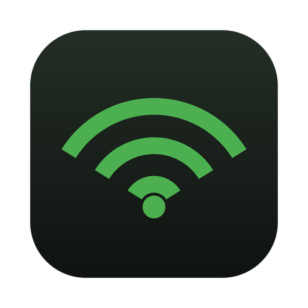
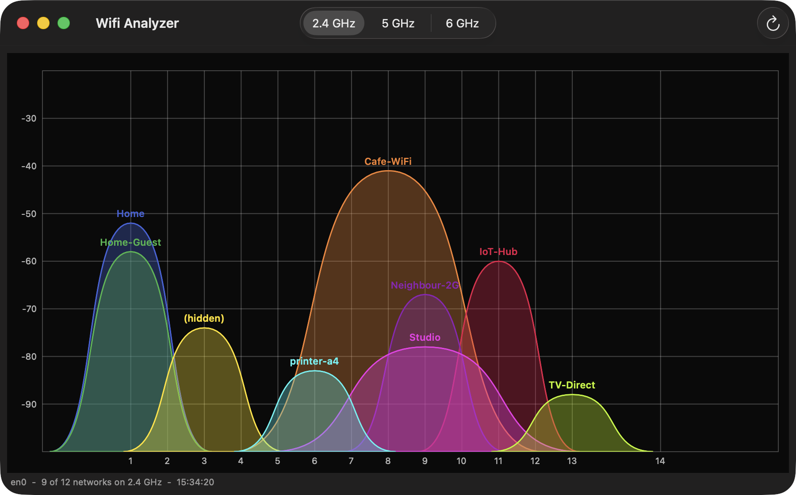

# R WiFi Analyzer - macOS

*[English version](README.md)*

*macOS 포트입니다. [Windows Phone](../winphone)과 [RenkuOS](../renkuos) 포트는
[저장소 README](../README.ko.md)를 보세요.*

macOS 14(Sonoma) 이상용 Wi-Fi 채널/신호 세기 그래프입니다. 주변의 모든 AP를 자기가 쓰는 채널 위에 곡선으로 그립니다. 높이는 dBm 신호 세기입니다.

- 2.4GHz, 5GHz, 6GHz. 타이틀 바에서 전환
- 5초마다 자동 재스캔, 수동 갱신도 가능
- 같은 네트워크는 스캔이 바뀌어도 같은 색 유지
- 넓은 채널은 실제 폭으로, 실제 점유하는 위치에 그립니다



## 빌드하기

Xcode 커맨드라인 도구가 필요합니다(`xcode-select --install`). Xcode 프로젝트는 없습니다.
SwiftPM이 실행 파일을 만들고, Makefile이 그 주위에 앱 번들을 조립합니다.

```
cd mac
make
open "./R WiFi Analyzer.app"
```

`make install`은 `/Applications`에 `R WiFi Analyzer.app`으로 복사합니다. `make ARCHS="arm64 x86_64"`는 유니버설
바이너리를 만듭니다. `make run`은 빌드와 실행을 한 번에 합니다.

## 왜 위치 권한을 요구하나

macOS에서는 네트워크 이름을 여는데에 위치 권한이 필요하기 때문입니다. 그 외의 용도는 없습니다.

macOS는 Wi-Fi 네트워크의 식별자를 위치 정보로 취급합니다(BSSID는 지도에서 조회할 수
있으니까요). 그래서 위치 서비스 권한이 없는 앱에게는 CoreWLAN이 `ssid`, `bssid`,
`countryCode`를 가려버립니다. 채널과 신호 세기를 포함한 나머지는 절대 가리지 않습니다.
즉 그래프 자체는 어느 쪽이든 정확하고, 권한이 없으면 모든 곡선의 라벨이 `(hidden)`이
될 뿐입니다.

**앱은 위치를 전송하지 않습니다.** 실행할 때
`CLLocationManager.requestWhenInUseAuthorization()`을 한 번 호출하는 것이 전부입니다.
`startUpdatingLocation`도, 좌표를 받는 델리게이트 메서드도 없고, 어디에 저장하거나
전송하지도 않습니다. 거부해도 이름만 안 보일 뿐 앱은 그대로 동작합니다.

프롬프트를 닫아버렸는데 이름을 보고 싶다면 **시스템 설정 → 개인정보 보호 및 보안 →
위치 서비스 → R WiFi Analyzer**에서 켜세요.

`make`는 번들을 ad-hoc으로 서명합니다. 즉 빌드마다 앱의 신원이 바뀌고 macOS는 매번 새 앱
으로 취급하므로, 권한을 다시 묻고 위치 서비스 목록에 항목이 쌓입니다. 권한을 유지하려면
실제 인증서로 서명하세요:

```
make SIGN="Developer ID Application: Your Name (TEAMID)"
```

## 지원하지 않는 것

- **6GHz의 채널 폭.** 40MHz나 80MHz 네트워크는 비콘이 중심 주파수를 알려주므로 실제 폭으로
  그립니다. 다만 6GHz는 그 정보가 아직 읽지 않는 요소에 들어있어서, 6GHz 네트워크는 주 채널
  위에 22MHz로 그려집니다. 좁게 그려질 뿐, 엉뚱한 위치에 그려지지는 않습니다.
- **숨겨진 네트워크**는 `(hidden)`입니다. 위치 권한을 거부해서 이름이 가려진 경우도 같은
  표시입니다. 둘 다 앱에는 이름이 전달되지 않으므로 구분할 방법이 없습니다.
- **기록은 남기지 않습니다.** 그래프는 마지막 스캔 결과뿐입니다.

## 그래프가 비어 있으면

- **"No Wi-Fi interface found"** - Wi-Fi가 꺼져 있거나 이 Mac에 Wi-Fi가 없습니다.
- **모든 라벨이 `(hidden)`** - 위 위치 권한 항목을 보세요. 그래프 자체는 정확합니다.
- **"Scan refused"** - 정상이고 무해합니다. 드라이버가 스캔 빈도를 제한하면 앱은 직전
  캐시를 씁니다. 다음 주기에 저절로 사라집니다.

스캔하는 동안 무선이 잠깐 채널을 벗어나므로, 5초마다 스캔하면 대역폭을 몇 퍼센트 정도
씁니다. 측정이 끝나면 창을 닫으세요.

빌드만 하는 게 아니라 코드를 수정하실 거라면 [AGENTS.md](AGENTS.md)를 먼저 읽어보세요.

## 라이선스

MIT - [LICENSE](../LICENSE) 참고.

## AI 기여 고지

이 프로그램은 Claude와 함께 작업해 만들었습니다.
