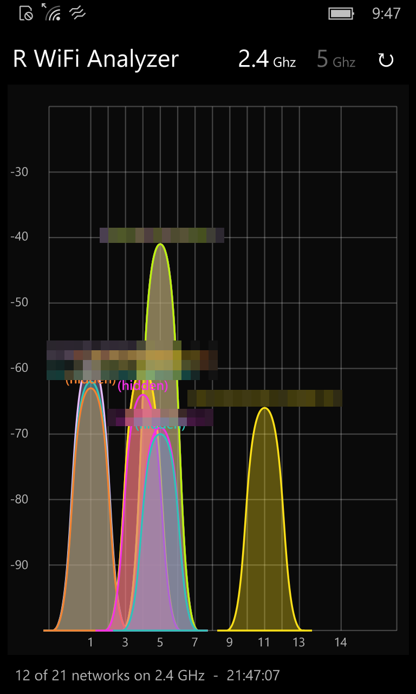

# R WiFi Analyzer - Windows 10 Mobile

*[English version](README.md)*

*Windows Phone 포트입니다. [macOS](../mac)와 [Haiku](../haiku) 포트는
[저장소 README](../README.ko.md)를 보세요.*

Windows 10 Mobile(Windows Phone 10)용 Wi-Fi 채널/신호 세기 그래프입니다. 주변의 모든
AP를 자기가 쓰는 채널 위에 곡선으로 그리고, 높이는 dBm 신호 세기입니다. 어느 채널이
붐비고 어느 채널이 비어 있는지 한눈에 보입니다.

- 2.4GHz와 5GHz, 헤더에서 전환
- 5초마다 자동 재스캔, 수동 갱신도 가능
- 같은 네트워크는 스캔이 바뀌어도 같은 색을 유지

빌드 10586(Windows 10 Mobile 1511) 이상을 대상으로 합니다.



## 폰에 설치하기

서명된 패키지가 [`dist/`](dist)에 들어있어서 빌드를 건너뛸 수 있습니다.

**빌드 10586 이상**이고 개발자 모드가 켜진 폰이 필요합니다:
**설정 → 업데이트 및 보안 → 개발자용 → 개발자 모드**.

1. 폰을 Windows PC에 USB로 연결합니다. `Windows phone`으로 나타납니다.
2. 다음 파일들을 폰의 **Downloads** 폴더로 복사합니다:
   - `dist/WifiAnalyzer_1.1.0.0_ARM.cer`
   - `dist/WifiAnalyzer_1.1.0.0_ARM.appx`
   - `dist/Dependencies/`의 파일 3개 (5번에서 실패할 때만 필요)
3. 폰에서 **파일 탐색기 → Downloads**를 열고 **`WifiAnalyzer_1.1.0.0_ARM.cer`를
   먼저** 탭해 인증서를 설치합니다. 파일 탐색기가 확장자를 숨기므로, 784바이트짜리가
   인증서입니다.
4. **`WifiAnalyzer_1.1.0.0_ARM.appx`** (420KB짜리)를 탭하면 설치되고, 앱 목록에
   **R WiFi Analyzer** 로 나타납니다.
5. 프레임워크가 없다는 오류가 나오면 `Dependencies` 패키지 3개를 먼저 탭한 뒤 4번을
   다시 하세요. 대부분의 폰에는 이미 들어있습니다.

3번은 건너뛸 수 없습니다. 인증서 없이는 앱 설치가 실패합니다.

1~2번은 스크립트로 됩니다. Windows 머신에서 `powershell -ExecutionPolicy Bypass -File
tools\copy-to-phone.ps1`을 실행하면 두 파일을 복사하고 도착까지 확인합니다. 3~4번은 폰에서
직접 탭해야 합니다(이유는 AGENTS.md 참고).

첫 실행 때 폰이 Wi-Fi 사용 권한을 묻습니다. 거부하면 그래프가 비고 상태 줄에 이유가
표시됩니다.

### 설치를 눌러도 아무 일도 일어나지 않으면

패키지가 요구하는 OS 버전이 폰보다 높을 때 폰이 그렇게 반응합니다(오류 메시지도
나오지 않습니다). **설정 → 정보 → 자세한 정보**에서 빌드 번호를 확인하세요.

### 동작하지 않는 도구들

`WinAppDeployCmd`, USB를 통한 Device Portal, Visual Studio의 F5 배포는 모두
`IpOverUsb` 서비스가 필요한데 Microsoft가 더 이상 배포하지 않습니다. 파일을 폰으로
복사하는 방법이 유일하게 동작합니다. (Wi-Fi를 통한 Device Portal은 폰에서 켜면 여전히
동작할 것입니다.)

## 직접 빌드하기

**Windows** 머신이 필요합니다. Windows 11도 되고, ARM64도 됩니다.

**1. Visual Studio 2017 Build Tools와 UWP 워크로드를 설치합니다.** VS2019 이후는
Windows Mobile 지원이 빠져서, 2017이 이걸 빌드할 수 있는 마지막 버전입니다. 디스크는
17GB 정도 필요합니다.

```
curl -L -o vs_buildtools.exe https://aka.ms/vs/15/release/vs_buildtools.exe
.\vs_buildtools.exe --quiet --norestart --wait ^
    --add Microsoft.VisualStudio.Workload.UniversalBuildTools --includeRecommended
```

`--log`은 넣지 마세요. 부트스트래퍼가 스스로를 최신 설치 엔진으로 업데이트하는데, 그
엔진이 이 옵션을 거부하고 아무 일도 하지 않은 채 코드 87로 종료합니다.

**2. 서명 인증서를 만듭니다.** 주체(subject)가 매니페스트의 `Publisher`와 정확히 같아야
합니다. PowerShell에서:

```powershell
$cert = New-SelfSignedCertificate -Type Custom -Subject "CN=WifiAnalyzer" `
  -KeyUsage DigitalSignature -FriendlyName "WifiAnalyzer sideload" `
  -CertStoreLocation "Cert:\CurrentUser\My" `
  -TextExtension @("2.5.29.37={text}1.3.6.1.5.5.7.3.3", "2.5.29.19={text}")
$cert.Thumbprint
```

**3. 빌드하고 패키징합니다.** `.pfx` 파일이 아니라 **지문(thumbprint)** 으로 서명하세요.
MSBuild의 키 파일 가져오기는 비밀번호가 맞아도 `APPX0105`로 실패합니다.

```powershell
$msbuild = "${env:ProgramFiles(x86)}\Microsoft Visual Studio\2017\BuildTools\MSBuild\15.0\Bin\MSBuild.exe"
& $msbuild WifiAnalyzer.csproj /t:Restore /p:Configuration=Release /p:Platform=ARM
& $msbuild WifiAnalyzer.csproj /p:Configuration=Release /p:Platform=ARM `
    /p:PackageCertificateThumbprint=$($cert.Thumbprint)
```

`ARM`을 쓰세요. Windows 10 Mobile 기기는 모두 32비트 ARM이고, `x86`은 폰 에뮬레이터용
빌드입니다.

그다음 위의 "폰에 설치하기"를 따르세요.

빌드만 하는 게 아니라 코드를 수정하실 거라면 [AGENTS.md](AGENTS.md)를 먼저 읽어보세요.

## 그래프 읽는 법

- **가로축** - 채널 번호. 20MHz 채널이 실제로는 22MHz를 차지하기 때문에 곡선 폭이
  22MHz입니다. 겹치는 곡선끼리는 서로 간섭합니다.
- **세로축** - dBm 신호 세기. 0에 가까울수록 강합니다. -50은 아주 좋고, -70은 쓸 만하고,
  -85 아래는 거의 안 잡힙니다.
- 2.4GHz에서 서로 겹치지 않는 채널은 **1, 6, 11** 셋뿐입니다. 이 중 아래에 깔린 게 가장
  적은 채널을 고르세요.

## 지원하지 않는 것

- **채널 폭은 알 수 없습니다.** 이 OS의 Wi-Fi API가 알려주지 않고, macOS/Haiku 포트가 폭을
  읽어내는 비콘 데이터에도 접근할 수 없어서, 40MHz나 80MHz 네트워크도 22MHz 폭으로
  그려집니다.
- **숨겨진 네트워크**는 `(hidden)`으로 표시됩니다. 비콘에 이름이 없습니다.
- **6GHz** - Windows 10 Mobile 기기 중에 해당 무선을 가진 게 없습니다.
- 이 앱은 어디에도 접속하지 않고 듣기만 합니다.

## 라이선스

MIT - [LICENSE](../LICENSE) 참고.

## AI 기여 고지

이 프로그램은 Claude와 함께 작업해 만들었습니다.
